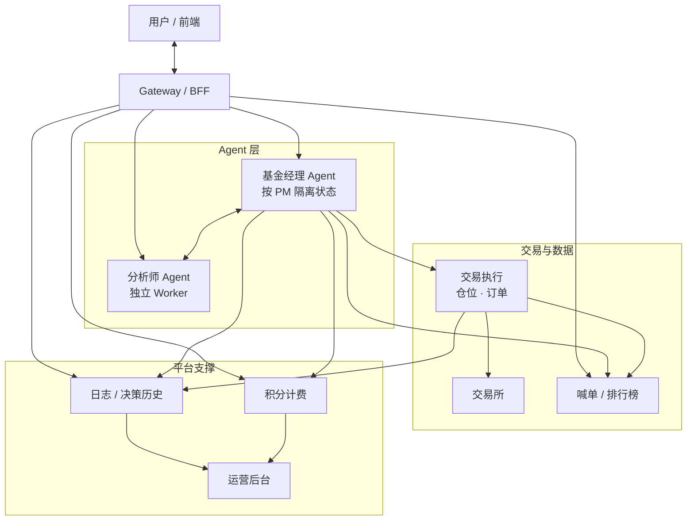

# 你好，我是 Alex 👋

后端工程师 / 公司技术负责人。主要做 AI 交易平台的后端与基础设施，擅长从0到1，习惯从业务问题一路做到部署和运维。

## 技术栈

- **主力**：Go（Gin / chi / Huma）、PostgreSQL、Redis、Kafka
- **常用**：MySQL、MongoDB、ClickHouse、BigQuery、Kubernetes、Terraform、ArgoCD、GCP / 腾讯云
- **了解**：TypeScript / React、Python

## AI 交易平台

一个跑在生产环境、用 Agent 做交易决策的平台：用户创建或关注 AI 基金经理、分析师 Agent，平台负责决策执行、实时喊单、排行榜、积分计费和运营。我负责整体技术架构，也亲手写后端和基础设施。

> 公司项目，代码未公开，以下只做脱敏描述。

**架构分工**：前端与 Agent 运行时在 Cloudflare，业务后端在 GCP。CF 成本低、前端团队熟悉；GCP 有创业扶持、后端团队熟悉 K8s。跨云只覆盖用户侧请求（展示、管理、查询），Agent 的下单执行不跨云。

**Agent 隔离**：基金经理 Agent 按 PM 隔离状态，交易所 API Key 等敏感凭证不跨 PM 共享；分析师 Agent 各自独立部署，通过统一 Dispatch Worker 路由。

### 云原生平台 · 从 0 到 1 与双云迁移

- 两代产品的基础设施均从零搭建：第一代在腾讯云 TKE，第二代迁到 GCP GKE，架构和运维体系保持连续。
- 作为公司技术负责人主导整体方案，并亲自落地架构、发布体系、身份与密钥、数据层连通、迁移割接和成本治理。
- GitOps：ArgoCD + Helm ApplicationSet 管理多服务、多环境；GitHub Actions 构建镜像并自动更新环境 tag。
- 身份与数据：GKE Workload Identity + 独立 GSA，CI 走 OIDC/WIF；Cloud SQL Auth Proxy + 共享 Cloud SQL/Redis，按服务做最小权限隔离。
- 迁移：双云并行、按服务割接，Kafka consumer group 隔离避免重复消费，保留回滚路径；旧云资源分批下线。
- 结果：环境可复现、发布自动化、权限收敛，固定成本下降。

### 实时喊单与排行榜

- 交易员的决策和喊单要实时推到前端，同时维护基金经理、分析师两套排行榜。
- 从 0 搭建 writer → Kafka → consumer → PostgreSQL/Redis → SSE 的链路。
- 关键设计：Kafka 削峰、消费幂等、Redis Pub/Sub 广播；SSE 用 afterSeq/afterTimestamp 支持断线续传；排行榜用 cache-aside + singleflight，全量缓存后内存排序。
- 结果：喊单广场和双榜查询稳定运行，事件可回放、消费可重试。

### Agent 可观测与 MCP 工具链

- 基金经理 Agent 和分析师 Agent 每天产生大量决策、订单、仓位日志，需要低成本查询和复盘。
- 搭建日志服务：冷数据写 BigQuery，热点决策索引写 PostgreSQL，提供跨 Agent 查询和订单/权益增量落账。
- 把决策查询从 BigQuery 全表扫改为 PG 索引表，消除超时；API Key 支持多 key 轮换。
- 封装 MCP Server，让管理员用自然语言复盘经营数据；并提供 Claude Code skills 包操作平台。

## 关注

- 实时数据链路与事件驱动架构
- 云原生、平台工程与成本治理
- AI Agent、MCP 与开发者工具

## 其他

- 接口契约用 Huma 声明请求/响应类型，自动生成 OpenAPI 3.1 和在线文档，减少文档与实现漂移。
- 做过支付回调、积分账务、过期扣减和运营后台。
